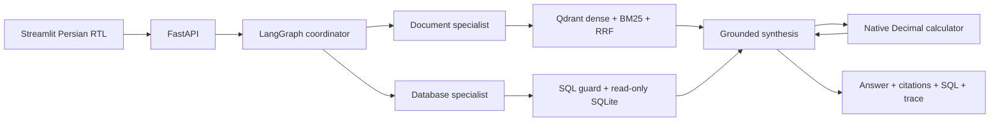

# Hamsafar — همسفر

A Persian travel guide and quotation assistant using public-source travel
observations, attributed PDFs, LLM-generated read-only SQL and a native
calculator. The RTL interface shows execution progress, PDF citations,
SQL/result rows, calculations and request traces.

## Start

Requires Docker Compose and an AvalAI key with access to chat and embeddings.

```bash
cp .env.example .env
# Set LLM_API_KEY in .env. Keep this file private.
docker compose up --build
```

- [Chat and sample scenarios](http://localhost:8501)
- [API documentation](http://localhost:8000/docs)
- [Readiness](http://localhost:8000/health/ready)
- [Ingestion report](http://localhost:8000/status)

The first start builds SQLite from the shipped JSONL, extracts text from the
PDFs, normalizes and chunks it, requests embeddings, and populates Qdrant.
Follow progress with `docker compose logs -f api`. Initialization needs provider
connectivity and consumes embedding credit. The tokenizer vocabulary is included
in the image.

No populated database, prebuilt chunks, vector index or evaluation answers are
copied into the image. Valid fingerprinted state is reused on subsequent starts;
changes to inputs, preprocessing or embedding configuration invalidate the
corresponding cache. SQLite/cache and Qdrant use separate persistent volumes.
`docker compose down` preserves them. Adding `--volumes` discards generated state
and requires embedding calls again at the next start.

## What the data establishes

Inventory and price observations were captured on **2026-10-18**. The conversation
reference date is **2026-10-27**; service dates are separate fields. Price and
capacity answers describe the captured observations and require revalidation
before booking. The assistant does not reserve inventory or make payments.

Structured sources are [Eghamat24](https://www.eghamat24.com/),
[Alibaba](https://www.alibaba.ir/) and [Safarmarket](https://safarmarket.com/).
The copied inputs contain 8,184 source records and 9,090 coverage observations.
Ingestion excludes 132 inventory probes and two collection-status reports,
leaving **8,050 business records**. There are 1,140 provider property listings;
these are not deduplicated physical hotels. The 6,806 price observations contain
1,413 exact departures, 4,905 room-night rows and 488 daily calendar entries.
All 34 exact train observations are sold out.

Only 15 properties have dated room rates, and 13 have rates marked available.
All bus arrival times are missing. Missing return legs, missing nights, failed
searches and unqueried dates remain explicit gaps. A calendar floor fare provides
neither a departure time nor confirmed seats. NULL restrictions do not establish
unrestricted booking. Catalog headline prices cannot replace dated room rates.

Canonical money uses integer **IRR**: ten rials equal one toman. Some values have
fractional toman, so conversion must not truncate them. Tickets are priced per
adult per direction; accommodation is priced per room per night. A multi-night
quote preserves the same property, room and rate plan across every requested
night. User allowances for food are separate from source prices. Unobserved
return, transfer and other expenses are excluded from a stated subtotal.

The five PDFs cover Mashhad, Shiraz and Isfahan culture, selected Mashhad hotel
conditions, and booking FAQs. Cultural sources were captured on 2026-10-27;
provider conditions retain their October 18 observation dates. Page citations
include the original source URLs. See the [data contract](docs/data-contract.md)
for identity, quote and attribution details.

## Try it

The UI has 24 sample prompts grouped into document questions, data searches,
cost comparisons and missing-evidence scenarios. A useful walkthrough is:

1. Ask about Mashhad food or hotel check-in; inspect the cited PDF page and URL.
2. Search Tehran → Mashhad flights on 2026-11-17; inspect generated SQL and rows.
3. Quote two adults, a one-way flight and two hotel nights on November 17–19;
   inspect the calculator call, then compare Almas 2 with Armaghan.
4. Compare bus fares; retain the missing arrival-time caveat.
5. Ask for the missing return on November 19, a train, or incomplete December
   nights; check that the response names the evidence gap.
6. Compare retrieval modes and inspect the ingestion report.

```bash
curl -sS http://localhost:8000/chat \
  -H 'Content-Type: application/json' \
  -d '{"question":"برای دو بزرگسال، یک اتاق و دو شب از 2026-11-17 تا 2026-11-19 در مشهد، اتاق دوتخته الماس ۲ و ارمغان را با جمع تومان، صرفه‌جویی و تفاوت وعده غذایی مقایسه کن.","retrieval_mode":"hybrid"}'
```

`/chat/stream` accepts the same body and emits SSE execution events followed by a
`result`. These are workflow progress events, not token-by-token model output.
Up to ten prior user/assistant messages support follow-ups. An interrupted stream
is not automatically replayed. Chat responses distinguish `answered`,
`insufficient_evidence`, `clarification`, `rejected` and `error`, and include a
request ID and trace.

## Observed output examples

These excerpts come from recorded live calls. DOC-01 and SQL-01 are successful
cases from an [earlier six-case baseline](reports/evaluation-v1-before-fixes.json)
that also contains two failures and predates later fixes. CALC-01 comes from a
[successful targeted quote run](reports/evaluation-v1-quote.json). They demonstrate
individual paths, not a claim that all 30 acceptance cases passed. Release
verification is recorded separately from these earlier runs.

**Document answer, DOC-01.** Asked about Mashhad museums, the assistant described
Astan Quds collections including carpets, coins and stamps, and associated the
Naderi Museum with Nader Shah. It cited `MASHHAD-2026-V1`, page 5, section
`MASH-04`, and explicitly declined to invent opening hours. The cited page is in
[the Mashhad guide](data/documents/mashhad-culture.pdf#page=5).

**Generated SQL, SQL-01.** For Mashhad property-record counts by provider, the
model generated and executed:

```sql
SELECT source, COUNT(*) AS record_count
FROM records
WHERE entity_type='property' AND city_fa='مشهد'
GROUP BY source;
```

| Source | Returned records |
|---|---:|
| alibaba | 8 |
| eghamat24 | 255 |
| safarmarket | 2 |

The answer preserved the distinction between provider records and unique
physical hotels.

**SQL → native calculator, CALC-01.** For two adults sharing one Almas 2 room
(room `29948`, plan `1107`) on November 17–19, SQL returned both nightly rates of
104,500,000 IRR, base occupancy 2 and inventory 10 per night. Two actual native
`calculate` calls produced:

```text
104500000 / 10                    → 10,450,000 toman per room/night
(104500000 + 104500000) / 10       → 20,900,000 toman for both nights
```

The response retained unspecified stay restrictions as unknown. This is one
room's observed-price subtotal for the selected breakfast plan; transport and
other unpriced expenses are outside it. It does not confirm a current booking.

## Architecture and retrieval



The coordinator produces up to three independent read-only queries when a request
needs separate fare and stay evidence. Quote checks preserve requested dates,
legs, identifiers, occupancy and compatible nightly groups. Known restrictions
are evaluated from returned evidence; unrecorded restrictions remain explicit
limitations of an observed-price quote.

PDF processing removes repeated headers/footers, normalizes Persian Unicode and
preserves page/section provenance. Defaults are a 320-token chunk budget and
40-token overlap. Chat expands matches to page context and retains matched and
supporting chunk IDs. Retrieval comparisons use the original section chunks.
The default embedding model is `text-embedding-3-small`, returning 1,536 dimensions.

Compare dense search, BM25, hybrid RRF and optional LLM listwise reranking.
Reranking adds a provider call and is not assumed to improve results. Filters
support `document_id`, `document_type`, `city`, `property_id` and `source`.
Document property filters use the provider property ID, paired with the source;
SQL `properties.record_id` uses the internal source-qualified hash. Scores are
ranking signals, not probabilities.

```bash
curl -sS 'http://localhost:8000/retrieval/compare?include_rerank=false' \
  -H 'Content-Type: application/json' \
  -d '{"query":"برای شناخت خوراک و دیدنی‌های مشهد چه پیشنهادهایی داریم؟","limit":6,"filters":{"city":"مشهد"}}'
```

## Tests and evaluation

For local development, use Python 3.12, uv and Poppler (`pdftotext`).

```bash
uv sync --frozen
.venv/bin/python -m pytest -q
```

Offline guard checks require the generated database. If Docker initialized it,
copy that processed database out before running them:

```bash
mkdir -p var
docker compose cp api:/app/var/travel.sqlite var/travel.sqlite
.venv/bin/python -m evaluation.run --mode offline \
  --output reports/evaluation-offline.json
```

The running API can be evaluated separately. These commands make real provider
calls and consume credit:

```bash
.venv/bin/python -m evaluation.run --mode live \
  --base-url http://localhost:8000 --output reports/evaluation-live.json

.venv/bin/python -m evaluation.run --mode retrieval \
  --base-url http://localhost:8000 --output reports/evaluation-retrieval.json

# Optional extra model calls for reranking:
.venv/bin/python -m evaluation.run --mode retrieval --include-rerank \
  --base-url http://localhost:8000 --output reports/evaluation-rerank.json
```

The 30 acceptance specifications comprise 26 live cases and four offline groups.
Four live cases contain two user turns. The offline groups cover four SQL attack
payloads and two injected provider/output failures. Twelve queries carry retrieval
labels. `--case-ids DOC-01 SQL-01` selects a smaller run. `--include-rerank` applies
to `retrieval` or `all` mode, not `live` or `offline` mode.

Expected values remain in `evaluation/` and are never supplied to application
requests. Mechanical checks cover observable execution, source references,
numeric equivalence and operand provenance; semantic answer quality is reviewed
separately. Retrieval reports include Recall/MRR measurements. A retrieval-mode
execution pass does not mean every gold page was found or that hybrid won.
A case marked `not_run` was not tested; the 30 specifications are not a claim of
30 successful live runs.

Recorded validation:

- **186 tests and 20 subtests passed:** [unit-test report](reports/unit-tests.xml).
- **Four offline guard/fault groups passed:** [offline results](reports/evaluation-travel-offline-final.json).
- **Three targeted release cases passed:** `CALC-02`, two-turn `BLEND-02` and
  `INS-04`; [release report](reports/evaluation-v1-release.json). This is the
  attempted release subset, not a full 30-case live pass.
- **Retrieval comparison executed:** [one-query report](reports/evaluation-v1-retrieval.json)
  includes dense, BM25, hybrid and real LLM reranking. All four found the expected
  source page on that query; this small check does not establish a quality winner.

The [source audit](reports/source-audit.json) records input/provenance checks.
Earlier baseline and quote examples above remain labeled as earlier runs. Live
reports identify attempted cases, the case-file hash and the run time; inspect
those fields before comparing runs.

## Configuration and boundaries

Defaults are `gpt-4.1` chat and `text-embedding-3-small` embeddings through
`https://api.avalai.org/v1`. Chat requires structured JSON output and native
function calling. Set `EMBEDDING_DIMENSIONS` to the size actually returned by the
selected model/provider: it validates vector size and does not request reduced
dimensions from the API. Provider, model and dimension settings form the
embedding cache identity.

Pacing defaults to 30 seconds, with at most two retries per provider operation.
Rate limits can make multistep responses slower. Input validation returns a safe
422 response; retrieval failures return sanitized error codes/messages. Optional
Langfuse settings are listed in `.env.example`; local traces work without them.

SQL validation checks the AST, tables, columns and functions before read-only
SQLite execution with a default-deny authorizer. Default limits are 100 returned
rows, 50 KB of result data and a two-second query deadline, with an additional
instruction budget. The calculator evaluates a bounded Decimal AST without
arbitrary Python execution. Currency-expression checks reject provable IRR/IRT
mismatches; full semantic faithfulness still requires answer review. The graph,
output repair and tool loops are bounded. Source IDs are checked against the
documents actually retrieved.

This is a local evaluation demo. Host API/UI ports bind to localhost; Qdrant is
internal to Compose. OCR, visual document reasoning, authentication and supplier
booking are outside v1. The Docker build context excludes credentials, the
private hiring brief, authoring tools, evaluation answers, reports and local
runtime state. The included provider archive is public-source material, not a
blanket open-data license; see the attribution and publication notes in the
[data contract](docs/data-contract.md).
