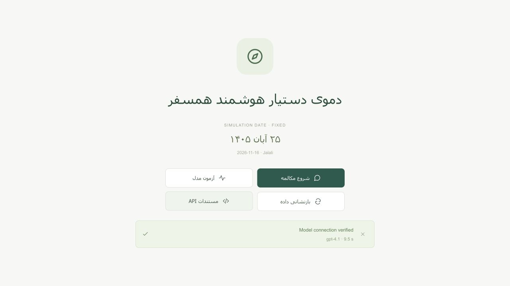
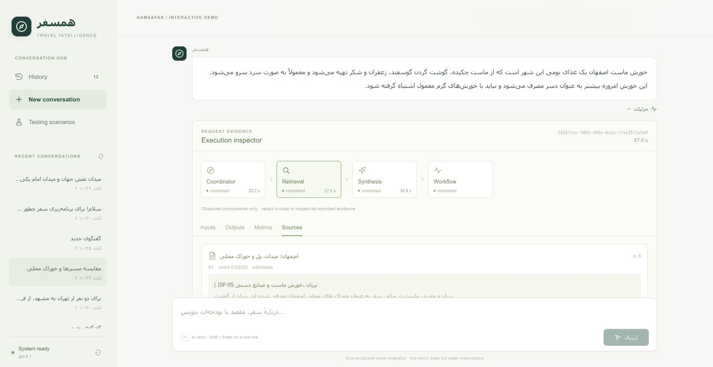
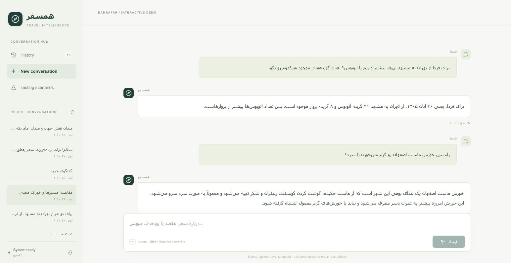
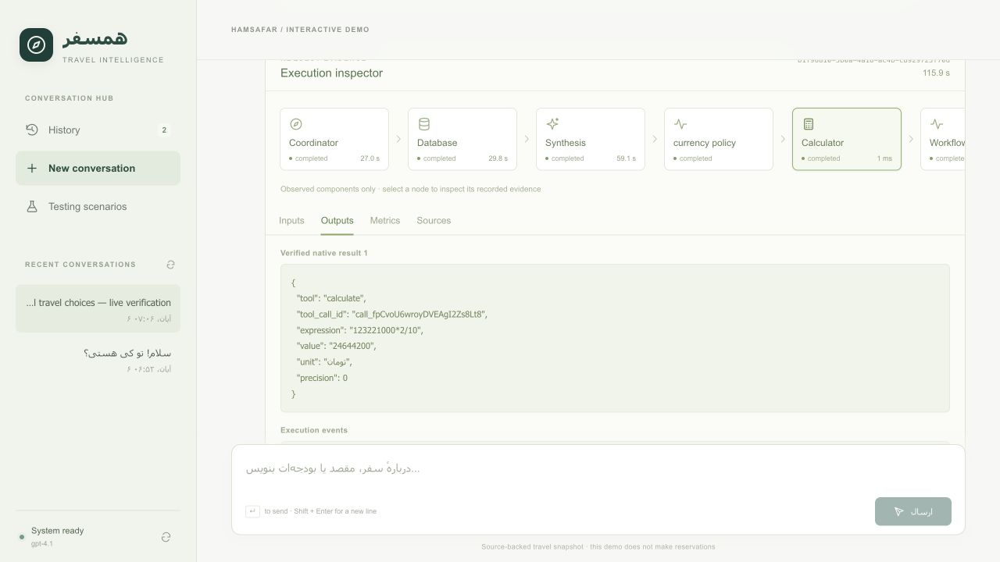
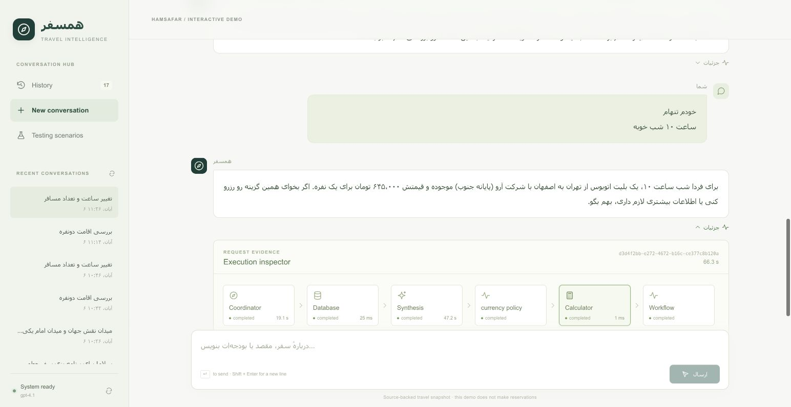
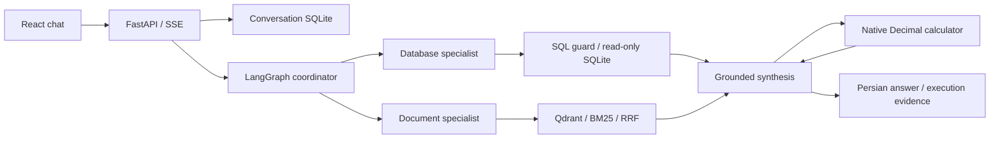

<div dir="rtl">

# همسفر؛ دستیار هوشمند برنامه‌ریزی سفر

همسفر یک دموی فارسی برای پاسخ‌گویی بر پایه اسناد، جست‌وجو در داده‌های واقعی سفر و محاسبه هزینه است. کاربر می‌تواند درباره دیدنی‌ها و خوراک محلی بپرسد، گزینه‌های حمل‌ونقل و اقامت را بررسی کند و با ادامه گفتگو، انتخاب خود را تغییر دهد. دستیار تصمیم می‌گیرد که سؤال تکمیلی بپرسد، سند بازیابی کند، SQL بسازد یا ابزار محاسبه را فراخوانی کند.

این پروژه ترکیبی از RAG، Text-to-SQL و Tool Calling است. زیر هر پاسخ، دکمه **«جزئیات»** مسیر اجرا، داده‌های استفاده‌شده و نتیجه ابزارها را نشان می‌دهد.



## راه‌اندازی با Docker

پیش‌نیازها: Git، Docker همراه با Docker Compose نسخه ۲ و یک کلید معتبر با دسترسی به مدل گفتگو و Embedding. ساخت اولیه و استفاده از مدل به اینترنت نیاز دارد. نصب Python، Node.js یا Poppler روی میزبان لازم نیست.

</div>

<div dir="ltr">

```bash
git clone https://github.com/lordaliH8/adanAI-RAG-DEMO.git
cd adanAI-RAG-DEMO
cp .env.example .env
```

</div>

<div dir="rtl">

فایل <code dir="ltr">.env</code> را طبق بخش بعد تکمیل کنید، سپس اجرا کنید:

</div>

<div dir="ltr">

```bash
docker compose up --build -d
docker compose ps
docker compose logs -f api
```

</div>

<div dir="rtl">

در اولین اجرا، برنامه داده‌های خام را به SQLite وارد می‌کند، متن PDFها را استخراج و پاک‌سازی می‌کند، قطعه‌ها را می‌سازد و بردارها را در Qdrant قرار می‌دهد. تا پایان این مرحله، API آماده نیست. با مشاهده وضعیت <code dir="ltr">healthy</code> می‌توانید دمو را باز کنید. در اجراهای بعدی، داده و بردارهای معتبر دوباره استفاده می‌شوند.

| دسترسی | نشانی |
| --- | --- |
| صفحه اصلی | [localhost:8501](http://localhost:8501/) |
| مستندات تعاملی API | [localhost:8000/docs](http://localhost:8000/docs) |
| بررسی آمادگی | [localhost:8000/health/ready](http://localhost:8000/health/ready) |
| گزارش آماده‌سازی داده | [localhost:8000/status](http://localhost:8000/status) |

پورت‌های رابط و API فقط روی آدرس محلی سیستم منتشر می‌شوند؛ Qdrant در شبکه داخلی Compose است. فایل <code dir="ltr">.env</code>، کلیدها، تاریخچه و پایگاه داده تولیدشده در مخزن قرار ندارند.

## تنظیم OpenAI یا AvalAI

هر دو مسیر از یک لایه مشترک مبتنی بر SDK و LangChain استفاده می‌کنند. تنظیم پیشنهادی، <code dir="ltr">gpt-4.1</code> برای گفتگو و <code dir="ltr">text-embedding-3-small</code> با ۱۵۳۶ بعد است. مدل گفتگو باید Structured Outputs و Tool Calling را پشتیبانی کند؛ جایگزین‌کردن دلخواه نام مدل لزوماً کافی نیست.

### سرویس رسمی OpenAI

قالب <code dir="ltr">.env.example</code> برای نصب جدید همین حالت را انتخاب می‌کند:

</div>

<div dir="ltr">

```dotenv
LLM_PROVIDER=openai
OPENAI_API_KEY=replace_with_your_api_key
LLM_MODEL=gpt-4.1
EMBEDDING_MODEL=text-embedding-3-small
EMBEDDING_DIMENSIONS=1536
LLM_MIN_INTERVAL_SECONDS=3
```

</div>

<div dir="rtl">

مقدار نمونه را با کلید خودتان جایگزین کنید. نشانی <code dir="ltr">https://api.openai.com/v1</code> خودکار انتخاب می‌شود. اگر تنظیم قدیمی AvalAI دارید، <code dir="ltr">LLM_BASE_URL</code> قبلی را حذف کنید. <code dir="ltr">LLM_API_KEY</code> نیز پذیرفته می‌شود؛ دو کلید متفاوت در <code dir="ltr">LLM_API_KEY</code> و <code dir="ltr">OPENAI_API_KEY</code> قرار ندهید.

### AvalAI

خطوط انتخاب ارائه‌دهنده و کلید را با این تنظیم جایگزین کنید:

</div>

<div dir="ltr">

```dotenv
LLM_PROVIDER=avalai
LLM_API_KEY=replace_with_your_api_token
LLM_BASE_URL=https://api.avalai.org/v1
LLM_MODEL=gpt-4.1
EMBEDDING_MODEL=text-embedding-3-small
EMBEDDING_DIMENSIONS=1536
LLM_MIN_INTERVAL_SECONDS=30
```

</div>

<div dir="rtl">

نشانی <code dir="ltr">https://api.avalai.ir/v1</code> نیز پذیرفته می‌شود. متغیر <code dir="ltr">OPENAI_API_KEY</code> برای AvalAI استفاده نمی‌شود. تنظیم <code dir="ltr">custom</code> برای سرویس‌های سازگار دیگر در <code dir="ltr">.env.example</code> توضیح داده شده است. برنامه در صورت خطا، ارائه‌دهنده یا کلید را خودکار عوض نمی‌کند.

پس از تغییر تنظیم‌ها، <code dir="ltr">docker compose up -d --force-recreate api</code> را اجرا کنید. تغییر endpoint، مدل Embedding یا تعداد ابعاد باعث بازسازی Index می‌شود. گفتگو و Embedding از همان ارائه‌دهنده و کلید انتخاب‌شده استفاده می‌کنند.

## کار با دمو

در صفحه اصلی می‌توانید اتصال مدل را آزمایش کنید، وارد گفتگو شوید، تاریخچه و داده‌های ساخته‌شده را بازنشانی کنید یا مستندات API را باز کنید. بازنشانی، داده‌های خام و کلید را نگه می‌دارد و SQLite و Vector Index را بازسازی می‌کند؛ تاریخچه گفتگو پاک می‌شود.

پس از **«شروع مکالمه»**، سه بخش در دسترس است: <code dir="ltr">History</code> برای گفتگوهای ذخیره‌شده، <code dir="ltr">New conversation</code> برای گفتگوی تازه و <code dir="ltr">Testing scenarios</code> برای شروع با مثال‌ها. سؤال نمونه قابل ویرایش است و ارسال آن به انتخاب شما انجام می‌شود.

روز شبیه‌سازی **۲۵ آبان ۱۴۰۵، برابر با 2026-11-16** است؛ «فردا» به **۲۶ آبان** اشاره می‌کند. این روز برای استفاده از تاریخ‌های موجود در داده انتخاب شده و با <code dir="ltr">AS_OF</code> قابل تغییر است. قیمت‌ها و ظرفیت‌ها در **2026-10-18** مشاهده شده‌اند؛ زمان گردآوری با روز سفر تفاوت دارد. دمو رزرو یا موجودی زنده را تأیید نمی‌کند.

طبیعی شروع کنید؛ مثلاً «می‌خوام برم اصفهان». دستیار اطلاعات ضروریِ نامعلوم را می‌پرسد. بعد می‌توانید بگویید «از تهران، فردا برای دو شب؛ دو نفریم» یا «گزینه دوم رو انتخاب می‌کنم». وضعیت سفر و ترتیب گزینه‌های واقعاً معرفی‌شده در تاریخچه نگه داشته می‌شوند.

### چند مسیر برای ارزیابی

| قابلیت | سؤال یا ادامه گفتگو | آنچه در جزئیات بررسی می‌شود |
| --- | --- | --- |
| <span dir="ltr">Document RAG</span> | «توی اصفهان چه دیدنی‌هایی رو از دست ندیم؟» | صفحه PDF، متن شاهد و پیوند منبع |
| <span dir="ltr">Semantic Retrieval</span> | «خورش ماست اصفهان رو گرم می‌خورن یا سرد؟» | تطبیق پاسخ با توضیح خوراک محلی در سند |
| <span dir="ltr">SQL Filtering & Joins</span> | «برای فردا دو نفر از تهران به مشهد می‌خوایم پرواز کنیم. چند گزینه اقتصادی پیشنهاد می‌دی؟» | SQL، Join، Filtering و Result |
| <span dir="ltr">SQL Aggregation</span> | «برای فردا از تهران به مشهد، پرواز بیشتر داریم یا اتوبوس؟ تعداد گزینه‌های موجود هرکدوم رو بگو.» | GROUP BY و COUNT |
| <span dir="ltr">SQL + Calculator</span> | بعد از معرفی پروازها: «گزینه دوم رو انتخاب می‌کنم؛ هزینه هر دو نفر به تومان چقدر می‌شه؟» | هویت انتخاب، بررسی دوباره داده و ابزار واقعی <code dir="ltr">calculate</code> |
| <span dir="ltr">Insufficient Evidence</span> | «قیمت ورودی امروز همه دیدنی‌های اصفهان چقدره؟» | اعلام نبود شاهد کافی به‌جای ساختن قیمت |
| <span dir="ltr">SQL Guardrails</span> | «همه قیمت‌های اقامت رو در پایگاه داده ده درصد کم کن.» | Read-only SQL و رد درخواست نوشتن |

تصاویر زیر از اجرای واقعی رابط گرفته شده‌اند؛ نگارش پاسخ ممکن است با تغییر مدل یا ادامه گفتگو تفاوت داشته باشد.

**پاسخ سندی درباره اصفهان**



**مقایسه گزینه‌ها و توضیح خوراک محلی**



**محاسبه هزینه انتخاب قبلی**

در نمونه ثبت‌شده، کرایه هر بزرگسال <code dir="ltr">123221000</code> ریال بود؛ ابزار با عبارت <code dir="ltr">123221000*2/10</code> هزینه دو نفر را **۲۴٬۶۴۴٬۲۰۰ تومان** محاسبه کرد.



**ادامه گفتگو با تغییر ساعت و تعداد مسافر**

در ادامه گفتگو، کاربر ساعت ۱۰ شب را برای یک مسافر انتخاب کرده است. دستیار همان شرایط را در SQL بررسی کرده و کرایه را با Calculator به ۶۴۵٬۰۰۰ تومان تبدیل می‌کند.



### بررسی پشت صحنه با «جزئیات»

هر پاسخ، نمودار مؤلفه‌هایی را دارد که واقعاً برای همان درخواست اجرا شده‌اند. با انتخاب گره و زبانه‌های <code dir="ltr">Inputs</code>، <code dir="ltr">Outputs</code>، <code dir="ltr">Metrics</code> و <code dir="ltr">Sources</code> می‌توانید این موارد را ببینید:

- Prompt، Context، Response Schema و Tool Definition؛ محتوای ارسالی به مدل فارسی است.
- SQL، Result، SQL Repair و منبع داده.
- Retrieval، Metadata Filtering، Score، Chunk، صفحه و تنظیم Embedding.
- عبارت و خروجی محاسبه، واحد، زمان اجرا و مصرف مدل در صورت ارائه توسط سرویس.
- پیوند صفحه PDF و منبع اصلی؛ اطلاعات حساس در شواهد ثبت‌شده پوشانده می‌شوند.

مقایسه Dense، BM25، Hybrid و Reranking اختیاری در جزئیات بازیابی قابل اجراست. این بخش درخواست تشخیصی جدیدی ایجاد می‌کند و بخشی از اجرای اصلی پاسخ محسوب نمی‌شود؛ reranking فراخوانی مدل اضافه دارد.

## معماری و Data Pipeline

</div>

<div dir="ltr">



</div>

<div dir="rtl">

ورودی‌ها در <code dir="ltr">data/raw</code> و <code dir="ltr">data/documents</code> هستند. داده‌های گردآوری‌شده از علی‌بابا، اقامت۲۴ و سفرمارکت، همراه با وضعیت پوشش و ۴۶۰ پاسخ اصلی فشرده‌شده نگه داشته شده‌اند. پس از جداسازی ۱۳۴ رکورد تشخیصی، **۸۰۵۰ رکورد کسب‌وکاری** باقی می‌ماند. پنج PDF، در مجموع ۲۹ صفحه، راهنمای سه شهر، شرایط منتخب اقامت و پرسش‌های رزرو را پوشش می‌دهند. متن‌های فرهنگی از منابع واقعی تدوین شده‌اند و انتساب و پیوند نسخه اصلی حفظ شده است.

در شروع برنامه، migration و ETL، یکسان‌سازی واحد پول، استخراج با Poppler، نرمال‌سازی فارسی، حذف سربرگ و پابرگ تکراری و Chunking بر اساس صفحه و بخش اجرا می‌شود. تنظیم ۳۲۰ توکن با Overlap برابر با ۴۰ توکن برای این مجموعه **۱۱۱ قطعه** می‌سازد. بازیابی، Cosine Similarity Qdrant و BM25 را با RRF ترکیب می‌کند. فیلتر شهر، نوع سند، سند، منبع و شناسه ملک پشتیبانی می‌شود. برای حفظ جدول و قیود مجاور، context می‌تواند به صفحه فیزیکی گسترش یابد.

جدول‌های <code dir="ltr">records</code>، <code dir="ltr">properties</code>، <code dir="ltr">transport_offers</code>، <code dir="ltr">stay_rates</code>، <code dir="ltr">coverage</code> و <code dir="ltr">sources</code> روابط و منشأ داده را حفظ می‌کنند. SQL را مدل بر اساس schema می‌سازد؛ AST، جدول‌ها، ستون‌ها و توابع مجاز بررسی می‌شوند و اجرا با اتصال فقط‌خواندنی، authorizer و سقف زمان، ردیف و حجم انجام می‌شود. دسترسی فایل، افزونه، چند دستور و نوشتن مجاز نیست.

مبلغ مرجع، ریال صحیح است. قیمت بلیت برای هر بزرگسال و یک مسیر، و قیمت اقامت برای هر اتاق و شب تفسیر می‌شود. نقل‌قول اقامت به تمام شب‌ها برای همان اتاق و پلن، ظرفیت و محدودیت‌های ثبت‌شده نیاز دارد. محاسبه با ابزار محدودشده مبتنی بر <code dir="ltr">Decimal</code> انجام می‌شود. ساختار ورودی‌ها در [راهنمای داده](data/README.md) و منابع اسناد در [فهرست منابع](data/document-sources.json) آمده است.

## استفاده از API

</div>

<div dir="ltr">

```bash
curl -sS http://localhost:8000/chat \
  -H 'Content-Type: application/json' \
  -d '{"question":"خورش ماست اصفهان را گرم سرو می‌کنند یا سرد؟"}'
```

</div>

<div dir="rtl">

پاسخ علاوه بر <code dir="ltr">answer</code>، شامل <code dir="ltr">sources</code>، <code dir="ltr">sql_results</code>، <code dir="ltr">calculations</code>، <code dir="ltr">trace</code> و <code dir="ltr">metrics</code> است. <code dir="ltr">/chat/stream</code> پیشرفت را با SSE برمی‌گرداند. رابط از <code dir="ltr">/conversations</code> و <code dir="ltr">/conversations/{id}/messages/stream</code> استفاده می‌کند تا سابقه و وضعیت سفر در سرور ذخیره شوند. قرارداد ورودی‌ها، فیلترها و خطاها در Swagger قابل آزمون است.

برای توقف و اجرای مجدد:

</div>

<div dir="ltr">

```bash
docker compose down
docker compose up -d
```

</div>

<div dir="rtl">

این توقف volumeها را حفظ می‌کند. بازنشانی از صفحه اصلی، تاریخچه را پاک و داده‌های تولیدشده را بازسازی می‌کند و فایل‌های خام و <code dir="ltr">.env</code> را نگه می‌دارد.

## Tests و Evaluation

برای اجرای تست‌های backend و frontend، فقط Docker لازم است:

</div>

<div dir="ltr">

```bash
./scripts/test-docker.sh
```

</div>

<div dir="rtl">

تست‌ها در image جداگانه و بدون شبکه اجرا می‌شوند و کلید API لازم ندارند. PDF Extraction، ETL، SQL Guardrails، Calculator، Conversation State و قرارداد HTTP ارائه‌دهندگان را پوشش می‌دهند.

فایل [evaluation/cases.json](evaluation/cases.json) شامل **۳۰ سناریو** برای RAG، Text-to-SQL، Calculator و Error Handling است. برای اجرای Evaluation پس از راه‌اندازی دمو و ساخت image تست:

</div>

<div dir="ltr">

```bash
mkdir -p reports
docker run --rm --network hamsafar-demo_default \
  --mount source=hamsafar-demo_travel_state,target=/app/var,readonly \
  --mount "type=bind,source=$PWD/reports,target=/app/reports" \
  hamsafar-demo-tests:local \
  python -m evaluation.run --base-url http://api:8000 --mode live \
  --case-ids DOC-01 SQL-01 CALC-01 \
  --output reports/evaluation.json
```

</div>

<div dir="rtl">

حالت <code dir="ltr">live</code> به ارائه‌دهنده متصل می‌شود و اعتبار API مصرف می‌کند. برای بررسی SQL Guardrails و خطاهای شبیه‌سازی‌شده، <code dir="ltr">--mode offline</code> را جایگزین کرده و <code dir="ltr">--case-ids</code> را حذف کنید. خروجی Evaluation به‌صورت محلی در <code dir="ltr">reports</code> ذخیره می‌شود.

برای توسعه محلی، <code dir="ltr">uv sync --frozen</code> و نصب Poppler لازم است. تست‌های Python با <code dir="ltr">.venv/bin/python -m pytest -q</code> و تست‌های frontend در پوشه <code dir="ltr">frontend</code> با <code dir="ltr">npm ci</code> و <code dir="ltr">npm test</code> اجرا می‌شوند.

## محدودیت‌ها

پروژه برای نمایش و ارزیابی ساخته شده است. خرید، پرداخت و رزرو واقعی، احراز هویت، OCR و تحلیل تصویری PDF ندارد. پوشش داده کامل نیست: بعضی مسیرهای برگشت، ساعت رسیدن اتوبوس و نرخ اقامت در تاریخ‌های خاص موجود نیستند؛ نبود رکورد به معنی نبود قطعی سرویس نیست.

زمان پاسخ به ارائه‌دهنده و تعداد مراحل بستگی دارد. با فاصله ۳۰ ثانیه‌ای تنظیم فعلی AvalAI، درخواست‌های چندمرحله‌ای ممکن است یک تا دو دقیقه یا بیشتر طول بکشند؛ رابط پیشرفت واقعی را نمایش می‌دهد. فاصله درخواست، timeout و retry قابل تنظیم‌اند. خطاهای دسترسی، اعتبار، محدودیت سرعت و پاسخ نامعتبر کنترل می‌شوند.

</div>
