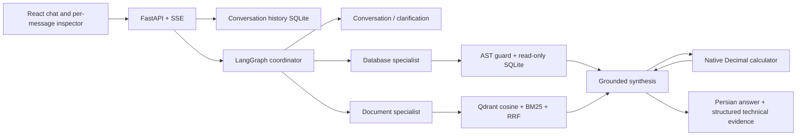

# Hamsafar — همسفر

A Persian travel assistant with natural conversation, source-grounded PDF answers,
LLM-generated read-only SQL and native Decimal calculations. A small React chat UI
keeps technical evidence inside each answer's English **Details** inspector.
Actual system prompts, model-facing explanations and user conversations are Persian.

## Run

Requires Docker Compose and an AvalAI key with chat and embedding access.

```bash
cp .env.example .env
# Set LLM_API_KEY; keep .env private.
docker compose up --build
```

- [Demo home](http://localhost:8501/)
- [API through the frontend proxy](http://localhost:8501/api/docs)
- [Direct backend API](http://localhost:8000/docs)
- [Readiness](http://localhost:8000/health/ready)
- [Ingestion report](http://localhost:8000/status)

The home page offers a real provider connection test, a demo reset, conversation
entry and an API link. Conversation history persists in a separate SQLite file
inside the state volume. A reset clears conversation history and rebuilds generated
SQL/vector state from the retained raw sources; it preserves the raw files and
credentials. Active work prevents a concurrent reset.

## Simulation and conversation

The default simulated day is **2026-11-16 / ۲۵ آبان ۱۴۰۵**. Thus “فردا” means
November 17, a date represented in the captured travel observations. `AS_OF` in
`.env` changes this clock. Gregorian/Jalali conversion uses `jdatetime`; the model
receives calendar mappings instead of inventing conversions.

The capture date and simulated travel date are different. Supplier prices and
capacities were observed on **2026-10-18**. They support demo estimates, not live
booking guarantees. Source dates and URLs remain inspectable in Details.

Start naturally, for example:

- «سلام! چطور می‌تونی برای سفر کمکم کنی؟»
- «می‌خوام برم اصفهان.» Then provide missing preferences conversationally.
- «از تهران، فردا برای دو شب؛ دو نفریم.»
- «یه گزینه ارزون‌تر داری؟» or «به‌جای هواپیما با قطار بریم.»
- «مشهد چه غذاها و موزه‌هایی داره؟»

The assistant chooses whether to converse, ask for missing preferences, search
structured data, retrieve documents or calculate. Follow-ups use stored trip state
and identities actually returned by SQL. Unknown inventory, missing nights and
ambiguous choices remain explicit. No scenario-to-answer or question-to-SQL lookup
is used. Scenario cards contain conversation starters, not oracle answers.

## Per-message technical inspection

A small live indicator reports real execution progress. Each completed assistant
message has a Details button. Its English inspector exposes executed components,
status and timings, with selectable inputs/outputs and source links:

- Coordinator and model calls: actual Persian prompts, context, structured output,
  tool definitions and usage when supplied by the provider.
- SQL: generated statements, safety/repair decisions, columns, rows and original
  supplier observation links.
- Retrieval: query, metadata filters, embedding model/dimensions, cosine search,
  BM25, RRF, selected chunks/pages and optional real LLM reranking.
- Calculator: native arguments, formula, result, units and any bounded correction.
- Synthesis/source validation: final status, selected evidence and PDF page links.

Retrieval comparisons are optional diagnostics inside retrieval details. They are
labeled separately from the original request. Original Persian prompts and source
excerpts remain unchanged under English technical labels. Secrets are redacted.

## Architecture



The first Docker start migrates and populates SQLite from JSONL, extracts real PDF
text with Poppler, normalizes Persian text, removes repeated headers/footers,
chunks by page/section, embeds and indexes into Qdrant. Defaults are 320 tokens
with 40-token overlap; answer context can expand a hit to its physical page.
Filters include city, document type, document ID, provider and provider property ID.

No populated database, prebuilt chunks, vector index or evaluation answers are
shipped in the image. Fingerprinted valid state is reused on subsequent starts.
`docker compose down` preserves state; `docker compose down --volumes` discards
regenerated state and causes new embedding calls on the next start.

## Data and safeguards

The source copy contains 8,184 provider records and 9,090 coverage observations,
with 460 hash-named original response bodies. Ingestion separates 134 collection
diagnostics, leaving **8,050 business records**: 1,140 provider property listings,
6,806 price observations and other source content/routes. Property listings are not
deduplicated physical hotels. Five attributed PDFs cover three cities, selected
hotel conditions and booking FAQs: 29 pages and 111 indexed chunks in the v1 corpus.
See the [source manifest](data/source-manifest.json),
[bibliography](data/document-sources.json) and [data contract](docs/data-contract.md).

SQL is generated by the LLM. A scoped AST/table/column/function allowlist is
followed by SQLite read-only mode, an authorizer and time/row/output limits.
Unsafe writes, multiple statements and filesystem/extension access are rejected.
A bounded repair can correct invalid SQL or a demonstrably suspect empty lookup.

Money is stored as integer IRR. Tickets are per adult/one direction and stays per
room/night. Quotes require all nights of the same property/room/plan, appropriate
observed inventory and known restrictions. Missing restrictions remain unknown.
The bounded Decimal AST calculator performs real native tool calls; conservative
unit checks reject provable rial/toman label mismatches. These checks do not
establish complete semantic faithfulness; answer/evidence review remains useful.

## API and validation

The original `/chat` and `/chat/stream` accept a question and optional bounded
history. The persistent conversation API creates a conversation, appends a streamed
message and returns the saved messages/details on reload. The UI uses `/api` through
Nginx; direct API routes remain on port 8000. Open Swagger for the exact schemas.

```bash
curl -sS http://localhost:8000/chat \
  -H 'Content-Type: application/json' \
  -d '{"question":"برای سفر به اصفهان کمکم می‌کنی؟"}'
```

```bash
uv sync --frozen
# Local tests need Poppler/pdftotext.
.venv/bin/python -m pytest -q
cd frontend && npm ci && npm test && npm run build
```

`evaluation/cases.json` retains 30 technical acceptance specifications across RAG,
NL2SQL, calculation, actual multi-turn combinations, insufficiency, SQL attacks and
controlled provider failures. These expected values are excluded from runtime and
never supplied to application prompts. Earlier v1 reports are historical evidence,
not a claim the redesigned conversation flow passed every live case.

```bash
mkdir -p var
docker compose cp api:/app/var/travel.sqlite var/travel.sqlite
.venv/bin/python -m evaluation.run --mode offline
.venv/bin/python -m evaluation.run --mode live --case-ids DOC-01 SQL-01 CALC-01
.venv/bin/python -m evaluation.run --mode retrieval --include-rerank --max-cases 1
```

Current verification: **243 Python tests and 33 subtests passed**, including actual
Poppler extraction, plus **6 frontend tests** and both Docker builds. Four offline
guard/fault groups passed; these are injected boundary tests, not provider calls.
Six actual AvalAI conversation turns covered greetings, incremental clarification,
PDF answers, flight choices and selecting a previous option with calculated pricing.
The [v2 verification report](reports/verification-v2.json) records 11 mechanical
checks and links the complete request evidence. This is a focused live check, not
a claim that all 30 acceptance specifications passed against the provider.

Recorded evidence: [source audit](reports/source-audit.json),
[unit tests](reports/unit-tests.xml), [v2 offline guard/fault checks](reports/evaluation-v2-offline.json),
[live travel follow-up](reports/conversation-v2-live.json) and
[live clarification/PDF conversation](reports/conversation-v2-clarification.json).
The [earlier v1 release checks](reports/evaluation-v1-release.json) remain historical.

## Configuration and limits

Defaults: `gpt-4.1` chat and `text-embedding-3-small` embeddings through AvalAI's
OpenAI-compatible endpoint. `EMBEDDING_DIMENSIONS` must match the returned vectors.
Provider pacing/retries are bounded; a depleted-credit response is not retried.
Complex requests can take time under the account's limits; SSE shows progress.
Optional Langfuse tracing is configured in `.env.example`; local details work
without it. The API/UI bind to localhost, and Qdrant is internal to Compose.

There is no live reservation/payment integration, authentication, OCR or visual PDF
reasoning. Dataset coverage is sparse: missing return legs and bus arrival times
are real gaps, and only a subset of properties has available dated room rates.
Wikimedia attribution/revision/license notices are retained. Commercial-source
archive metadata does not assert a blanket redistribution license; see the data
contract's attribution section. Keep credentials and the private hiring brief out
of repository publication.
