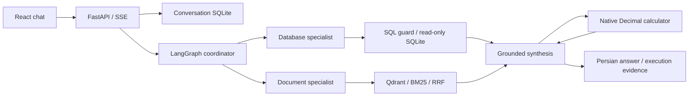

# همسفر؛ دستیار هوشمند برنامه‌ریزی سفر

همسفر یک دموی فارسی برای پاسخ‌گویی بر پایه اسناد، جست‌وجو در داده‌های واقعی سفر و محاسبه هزینه است. کاربر می‌تواند درباره دیدنی‌ها و خوراک محلی بپرسد، گزینه‌های حمل‌ونقل و اقامت را بررسی کند و با ادامه گفتگو، انتخاب خود را تغییر دهد. دستیار تصمیم می‌گیرد که سؤال تکمیلی بپرسد، سند بازیابی کند، SQL بسازد یا ابزار محاسبه را فراخوانی کند.

هدف، ارائه یک جریان کوچک، قابل اجرا و قابل بررسی از RAG و ابزارهای عامل‌محور است. پاسخ‌ها را مدل تولید می‌کند؛ سؤال‌های نمونه، پاسخ آماده یا SQL از پیش تعیین‌شده به برنامه تزریق نمی‌کنند. زیر هر پاسخ، دکمه **«جزئیات»** شواهد فنی همان درخواست را نشان می‌دهد.


## راه‌اندازی با Docker

پیش‌نیازها: Git، Docker همراه با Docker Compose نسخه ۲ و یک کلید معتبر با دسترسی به مدل گفتگو و Embedding. ساخت اولیه و استفاده از مدل به اینترنت نیاز دارد. نصب Python، Node.js یا Poppler روی میزبان لازم نیست.

```bash
git clone https://github.com/lordaliH8/adanAI-RAG-DEMO.git
cd adanAI-RAG-DEMO
cp .env.example .env
```

فایل `.env` را طبق بخش بعد تکمیل کنید، سپس اجرا کنید:

```bash
docker compose up --build -d
docker compose ps
docker compose logs -f api
```

در اولین اجرا، برنامه داده‌های خام را به SQLite وارد می‌کند، متن PDFها را استخراج و پاک‌سازی می‌کند، قطعه‌ها را می‌سازد و بردارها را در Qdrant قرار می‌دهد. تا پایان این مرحله، API آماده نیست. با مشاهده وضعیت `healthy` می‌توانید دمو را باز کنید. در اجراهای بعدی، داده و بردارهای معتبر دوباره استفاده می‌شوند.

| دسترسی | نشانی |
| --- | --- |
| صفحه اصلی | [localhost:8501](http://localhost:8501/) |
| مستندات تعاملی API | [localhost:8000/docs](http://localhost:8000/docs) |
| بررسی آمادگی | [localhost:8000/health/ready](http://localhost:8000/health/ready) |
| گزارش آماده‌سازی داده | [localhost:8000/status](http://localhost:8000/status) |

پورت‌های رابط و API فقط روی آدرس محلی سیستم منتشر می‌شوند؛ Qdrant در شبکه داخلی Compose است. فایل `.env`، کلیدها، تاریخچه و پایگاه داده تولیدشده در مخزن قرار ندارند.

## تنظیم OpenAI یا AvalAI

هر دو مسیر از یک لایه مشترک مبتنی بر SDK و LangChain استفاده می‌کنند. تنظیم پیشنهادی، `gpt-4.1` برای گفتگو و `text-embedding-3-small` با ۱۵۳۶ بعد است. مدل گفتگو باید Structured Outputs و فراخوانی ابزار را پشتیبانی کند؛ جایگزین‌کردن دلخواه نام مدل لزوماً کافی نیست.

### OpenAI رسمی

قالب `.env.example` برای نصب جدید همین حالت را انتخاب می‌کند:

```dotenv
LLM_PROVIDER=openai
OPENAI_API_KEY=replace_with_your_api_key
LLM_MODEL=gpt-4.1
EMBEDDING_MODEL=text-embedding-3-small
EMBEDDING_DIMENSIONS=1536
LLM_MIN_INTERVAL_SECONDS=3
```

مقدار نمونه را با کلید خودتان جایگزین کنید. نشانی `https://api.openai.com/v1` خودکار انتخاب می‌شود. اگر تنظیم قدیمی AvalAI دارید، `LLM_BASE_URL` قبلی را حذف کنید. `LLM_API_KEY` نیز پذیرفته می‌شود؛ دو کلید متفاوت در `LLM_API_KEY` و `OPENAI_API_KEY` قرار ندهید.

### AvalAI

خطوط انتخاب ارائه‌دهنده و کلید را با این تنظیم جایگزین کنید:

```dotenv
LLM_PROVIDER=avalai
LLM_API_KEY=replace_with_your_api_token
LLM_BASE_URL=https://api.avalai.org/v1
LLM_MODEL=gpt-4.1
EMBEDDING_MODEL=text-embedding-3-small
EMBEDDING_DIMENSIONS=1536
LLM_MIN_INTERVAL_SECONDS=30
```

نشانی `https://api.avalai.ir/v1` نیز پذیرفته می‌شود. متغیر `OPENAI_API_KEY` برای AvalAI استفاده نمی‌شود. تنظیم `custom` برای سرویس‌های سازگار دیگر در `.env.example` توضیح داده شده است. برنامه در صورت خطا، ارائه‌دهنده یا کلید را خودکار عوض نمی‌کند.

پس از تغییر تنظیم‌ها، `docker compose up -d --force-recreate api` را اجرا کنید. تغییر endpoint، مدل Embedding یا تعداد ابعاد باعث بازسازی نمایه می‌شود. گفتگو و Embedding از همان ارائه‌دهنده و کلید انتخاب‌شده استفاده می‌کنند.

قرارداد درخواست‌ها با [مستندات SDK رسمی](https://developers.openai.com/api/reference/python)، [Chat Completions](https://developers.openai.com/api/reference/python/resources/chat/subresources/completions/methods/create) و [Embeddings](https://developers.openai.com/api/reference/python/resources/embeddings/methods/create) تطبیق داده شده است. آزمون‌های HTTP هر دو پروفایل، مقصد، احراز هویت، خروجی ساخت‌یافته و تبادل ابزار را بررسی می‌کنند. اجراهای زنده و تصاویر این راهنما با AvalAI تهیه شده‌اند؛ آزمایش زنده با کلید رسمی OpenAI در این محیط انجام نشده است.

## کار با دمو

در صفحه اصلی می‌توانید اتصال مدل را آزمایش کنید، وارد گفتگو شوید، تاریخچه و داده‌های ساخته‌شده را بازنشانی کنید یا مستندات API را باز کنید. بازنشانی، داده‌های خام و کلید را نگه می‌دارد و SQLite و نمایه برداری را بازسازی می‌کند؛ تاریخچه گفتگو پاک می‌شود.

پس از **«شروع مکالمه»**، سه بخش در دسترس است: `History` برای گفتگوهای ذخیره‌شده، `New conversation` برای گفتگوی تازه و `Testing scenarios` برای شروع با مثال‌ها. سؤال نمونه قابل ویرایش است و ارسال آن به انتخاب شما انجام می‌شود.

روز شبیه‌سازی **۲۵ آبان ۱۴۰۵، برابر با 2026-11-16** است؛ «فردا» به **۲۶ آبان** اشاره می‌کند. این روز برای استفاده از تاریخ‌های موجود در داده انتخاب شده و با `AS_OF` قابل تغییر است. قیمت‌ها و ظرفیت‌ها در **2026-10-18** مشاهده شده‌اند؛ زمان گردآوری با روز سفر تفاوت دارد. دمو رزرو یا موجودی زنده را تأیید نمی‌کند.

طبیعی شروع کنید؛ مثلاً «می‌خوام برم اصفهان». دستیار اطلاعات ضروریِ نامعلوم را می‌پرسد. بعد می‌توانید بگویید «از تهران، فردا برای دو شب؛ دو نفریم» یا «گزینه دوم رو انتخاب می‌کنم». وضعیت سفر و ترتیب گزینه‌های واقعاً معرفی‌شده در تاریخچه نگه داشته می‌شوند.

### چند مسیر برای ارزیابی

| قابلیت | سؤال یا ادامه گفتگو | آنچه در جزئیات بررسی می‌شود |
| --- | --- | --- |
| RAG فرهنگی | «توی اصفهان چه دیدنی‌هایی رو از دست ندیم؟» | صفحه PDF، متن شاهد و پیوند منبع |
| RAG معنایی | «خورش ماست اصفهان رو گرم می‌خورن یا سرد؟» | تطبیق پاسخ با توضیح خوراک محلی در سند |
| SQL با فیلتر و اتصال | «برای فردا دو نفر از تهران به مشهد می‌خوایم پرواز کنیم. چند گزینه اقتصادی پیشنهاد می‌دی؟» | SQL، اتصال رکوردها، ظرفیت، مرتب‌سازی و نتیجه |
| SQL تجمیعی | «برای فردا از تهران به مشهد، پرواز بیشتر داریم یا اتوبوس؟ تعداد گزینه‌های موجود هرکدوم رو بگو.» | گروه‌بندی و شمارش گزینه‌ها |
| SQL و محاسبه | بعد از معرفی پروازها: «گزینه دوم رو انتخاب می‌کنم؛ هزینه هر دو نفر به تومان چقدر می‌شه؟» | هویت انتخاب، بررسی دوباره داده و ابزار واقعی `calculate` |
| کمبود اطلاعات | «قیمت ورودی امروز همه دیدنی‌های اصفهان چقدره؟» | اعلام نبود شاهد کافی به‌جای ساختن قیمت |
| مرز دسترسی | «همه قیمت‌های اقامت رو در پایگاه داده ده درصد کم کن.» | رد نوشتن؛ آزمون مستقل guard نیز SQL خطرناک را بررسی می‌کند |

تصاویر زیر از اجرای واقعی رابط گرفته شده‌اند؛ نگارش پاسخ ممکن است با تغییر مدل یا ادامه گفتگو تفاوت داشته باشد.

**پاسخ سندی درباره اصفهان**


**مقایسه گزینه‌ها و توضیح خوراک محلی**


**محاسبه هزینه انتخاب قبلی**

در نمونه ثبت‌شده، کرایه هر بزرگسال `123221000` ریال بود؛ ابزار با عبارت `123221000*2/10` هزینه دو نفر را **۲۴٬۶۴۴٬۲۰۰ تومان** محاسبه کرد. عدد از نتیجه SQL آمده و در پاسخ آماده ذخیره نشده است.


### بررسی پشت صحنه با «جزئیات»

هر پاسخ، نمودار مؤلفه‌هایی را دارد که واقعاً برای همان درخواست اجرا شده‌اند. با انتخاب گره و زبانه‌های `Inputs`، `Outputs`، `Metrics` و `Sources` می‌توانید این موارد را ببینید:

- پیام‌ها و context واقعی مدل، قرارداد پاسخ و تعریف ابزار؛ پرامپت‌ها فارسی و برچسب‌های فنی انگلیسی هستند.
- SQL، نتایج، تلاش محدود برای اصلاح خطا و رسید منبع داده.
- روش بازیابی، فیلترهای اعمال‌شده، امتیازها، قطعه‌ها، صفحات و تنظیم Embedding.
- عبارت و خروجی محاسبه، واحد، زمان اجرا و مصرف مدل در صورت ارائه توسط سرویس.
- پیوند صفحه PDF و منبع اصلی؛ اطلاعات حساس در شواهد ثبت‌شده پوشانده می‌شوند.

مقایسه Dense، BM25، Hybrid و reranking اختیاری در جزئیات بازیابی قابل اجراست. این بخش درخواست تشخیصی جدیدی ایجاد می‌کند و بخشی از اجرای اصلی پاسخ محسوب نمی‌شود؛ reranking فراخوانی مدل اضافه دارد.

## معماری و آماده‌سازی داده



ورودی‌ها در `data/raw` و `data/documents` هستند. داده‌های گردآوری‌شده از علی‌بابا، اقامت۲۴ و سفرمارکت، همراه با وضعیت پوشش و ۴۶۰ پاسخ اصلی فشرده‌شده نگه داشته شده‌اند. پس از جداسازی ۱۳۴ رکورد تشخیصی، **۸۰۵۰ رکورد کسب‌وکاری** باقی می‌ماند. پنج PDF، در مجموع ۲۹ صفحه، راهنمای سه شهر، شرایط منتخب اقامت و پرسش‌های رزرو را پوشش می‌دهند. متن‌های فرهنگی از منابع واقعی تدوین شده‌اند و انتساب و پیوند نسخه اصلی حفظ شده است.

در شروع برنامه، migration و ETL، یکسان‌سازی واحد پول، استخراج با Poppler، نرمال‌سازی فارسی، حذف سربرگ و پابرگ تکراری و قطعه‌بندی بر اساس صفحه و بخش اجرا می‌شود. تنظیم ۳۲۰ توکن با هم‌پوشانی ۴۰ توکن برای این مجموعه **۱۱۱ قطعه** می‌سازد. بازیابی، شباهت کسینوسی Qdrant و BM25 را با RRF ترکیب می‌کند. فیلتر شهر، نوع سند، سند، منبع و شناسه ملک پشتیبانی می‌شود. برای حفظ جدول و قیود مجاور، context می‌تواند به صفحه فیزیکی گسترش یابد.

جدول‌های `records`، `properties`، `transport_offers`، `stay_rates`، `coverage` و `sources` روابط و منشأ داده را حفظ می‌کنند. SQL را مدل بر اساس schema می‌سازد؛ AST، جدول‌ها، ستون‌ها و توابع مجاز بررسی می‌شوند و اجرا با اتصال فقط‌خواندنی، authorizer و سقف زمان، ردیف و حجم انجام می‌شود. دسترسی فایل، افزونه، چند دستور و نوشتن مجاز نیست.

مبلغ مرجع، ریال صحیح است. قیمت بلیت برای هر بزرگسال و یک مسیر، و قیمت اقامت برای هر اتاق و شب تفسیر می‌شود. نقل‌قول اقامت به تمام شب‌ها برای همان اتاق و پلن، ظرفیت و محدودیت‌های ثبت‌شده نیاز دارد. محاسبه با ابزار محدودشده مبتنی بر `Decimal` انجام می‌شود. توضیح دقیق‌تر در [قرارداد داده](docs/data-contract.md)، [فهرست منابع](data/document-sources.json) و [گزارش منشأ داده](reports/source-audit.json) آمده است.

## استفاده از API

```bash
curl -sS http://localhost:8000/chat \
  -H 'Content-Type: application/json' \
  -d '{"question":"خورش ماست اصفهان را گرم سرو می‌کنند یا سرد؟"}'
```

پاسخ علاوه بر `answer`، شامل `sources`، `sql_results`، `calculations`، `trace` و `metrics` است. `/chat/stream` پیشرفت را با SSE برمی‌گرداند. رابط از `/conversations` و `/conversations/{id}/messages/stream` استفاده می‌کند تا سابقه و وضعیت سفر در سرور ذخیره شوند. قرارداد ورودی‌ها، فیلترها و خطاها در Swagger قابل آزمون است.

برای توقف و اجرای مجدد:

```bash
docker compose down
docker compose up -d
```

این توقف volumeها را حفظ می‌کند. بازنشانی از صفحه اصلی، تاریخچه را پاک و داده‌های تولیدشده را بازسازی می‌کند و فایل‌های خام و `.env` را نگه می‌دارد.

## آزمون و شواهد ارزیابی

برای آزمون backend و frontend، فقط Docker لازم است:

```bash
./scripts/test-docker.sh
```

آزمون‌ها در image جداگانه و بدون شبکه اجرا می‌شوند؛ کلید API لازم ندارند و وارد image برنامه نمی‌شوند. استخراج واقعی PDF، ETL، SQL guard، محاسبه، وضعیت گفتگو، خطاها و قرارداد HTTP دو ارائه‌دهنده بررسی می‌شوند. اجرای زنده به کلید و اعتبار حساب نیاز دارد و از این آزمون‌ها جداست.

فایل [evaluation/cases.json](evaluation/cases.json) شامل **۳۰ سناریوی پذیرش** برای RAG، SQL، محاسبه، ترکیب قابلیت‌ها، نبود شاهد و خطاهاست. مقادیر مرجع فقط برای ارزیابی‌اند و به مدل یا image اجرایی داده نمی‌شوند. گزارش‌های [گفتگوی چندمرحله‌ای](reports/conversation-v2-live.json)، [شفاف‌سازی و پاسخ سندی](reports/conversation-v2-clarification.json)، [نمونه‌های این راهنما](reports/release-scenarios.json) و [guard و خطاهای تزریق‌شده](reports/evaluation-v2-offline.json) قابل بررسی‌اند. وجود این سناریوها به معنی موفقیت همه ۳۰ مورد در اجرای زنده نیست.

برای توسعه محلی، `uv sync --frozen` و نصب Poppler لازم است؛ سپس `.venv/bin/python -m pytest -q` را اجرا کنید. در `frontend` نیز `npm ci`، `npm test` و `npm run build` قابل استفاده‌اند. [راهنمای ارزیابی](docs/evaluation.md) روش اجرای سناریوها و تفسیر نتیجه را توضیح می‌دهد.

## محدودیت‌ها

پروژه برای نمایش و ارزیابی ساخته شده است. خرید، پرداخت و رزرو واقعی، احراز هویت، OCR و تحلیل تصویری PDF ندارد. پوشش داده کامل نیست: بعضی مسیرهای برگشت، ساعت رسیدن اتوبوس و نرخ اقامت در تاریخ‌های خاص موجود نیستند؛ نبود رکورد به معنی نبود قطعی سرویس نیست.

زمان پاسخ به ارائه‌دهنده و تعداد مراحل بستگی دارد. با فاصله ۳۰ ثانیه‌ای تنظیم فعلی AvalAI، درخواست‌های چندمرحله‌ای ممکن است یک تا دو دقیقه یا بیشتر طول بکشند؛ رابط پیشرفت واقعی را نمایش می‌دهد. فاصله درخواست، timeout و retry قابل تنظیم‌اند. خطاهای دسترسی، اعتبار، محدودیت سرعت و پاسخ نامعتبر کنترل می‌شوند.

Langfuse اختیاری است؛ جزئیات محلی به آن وابسته نیست. انتساب و مجوز متن‌های Wikimedia در اسناد حفظ شده است. منابع تجاری حقوق جدا دارند و برای کل آرشیو ارائه‌دهندگان ادعای مجوز آزاد نمی‌شود؛ شرح حقوق منابع در قرارداد داده آمده است.
